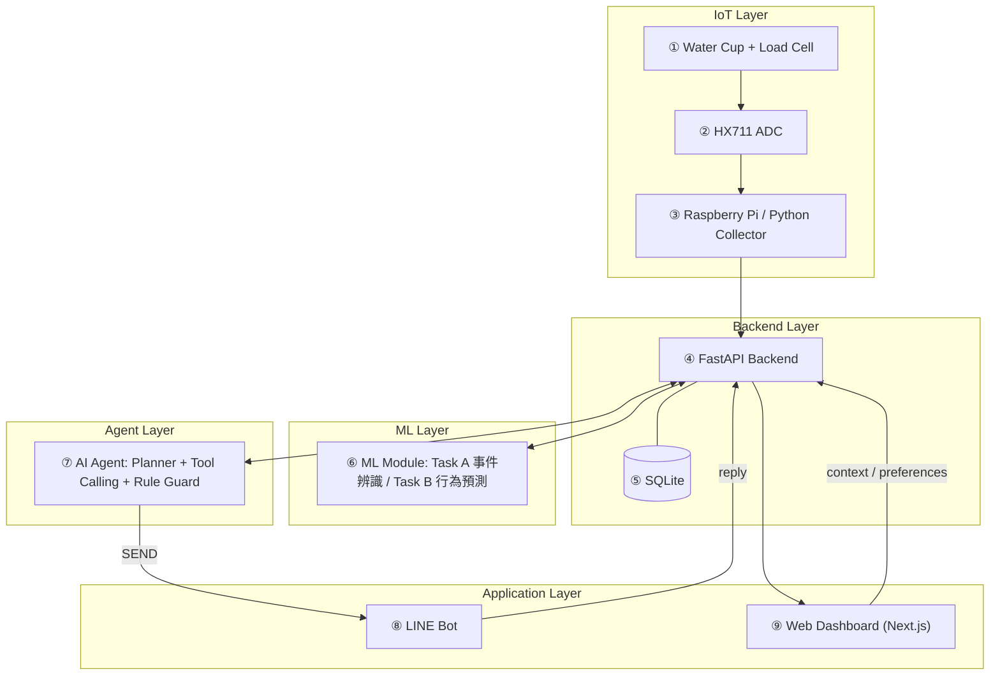
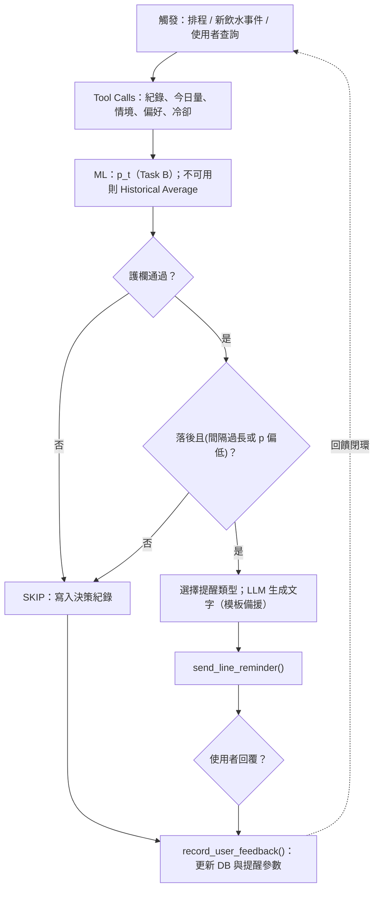

# DESIGN.md — Smart Hydration Monitoring Agent

> 狀態：**Proposal 階段（Planned）**。尚無實作與實驗結果；所有數值為 Planned / Expected / Illustrative Example。
> 本文件依課程要求持續維護，順序為 Problem → Requirements → Architecture → Components → Data → AI/Analytics → Domain Knowledge → Algorithm → Implementation → How to Run → Results。

## 0. 如何與 OpenSpec 搭配

| 文件 | 回答的問題 | 位置 |
|---|---|---|
| `openspec/changes/smart-hydration-monitoring-agent/proposal.md` | 為什麼做、做什麼、不做什麼 | OpenSpec |
| `.../specs/<capability>/spec.md` | 系統**必須**有什麼可觀察行為（SHALL + Scenario） | OpenSpec |
| `.../design.md` | 關鍵技術決策與取捨（D1–D5） | OpenSpec |
| `.../tasks.md` | 依週次的實作清單與驗證方式 | OpenSpec |
| **本檔 `DESIGN.md`** | 全貌：架構、資料、演算法、實作對照、如何執行、結果 | 根目錄 |

規則：**行為變更先改 spec，再改本檔與程式**；本檔不重複 spec 的 Requirement，只以 ID 引用（如 `reminder-decision-agent / Enforce guardrails`）。

工作流（OpenSpec 2.0.0）：`openspec validate <change> --strict` → 實作 → `openspec archive <change>` 把 delta 併入 `openspec/specs/`。

## 1. Problem

飲水提醒多依固定時間或靜態個資；重量式智慧水杯雖能自動記錄，卻少整合運動／飲食情境與提醒回饋；LLM 於 JITAI 的研究顯示系統能執行不代表提醒適當。證據與引用見 `docs/03-introduction.md`、`docs/references.md`。

研究問題：
- **RQ1** 低成本重量感測能否自動估計飲水事件與飲水量？
- **RQ2** 歷史飲水紀錄與活動情境能否建立個人化的飲水行為預測？（探索性）
- **RQ3** 整合 ML 預測、情境與回饋的 AI Agent，是否比固定提醒提供更適當的提醒策略？

## 2. Requirements

| ID | 需求 | Spec |
|---|---|---|
| R1 | 切片段、分類事件、只對飲水估量 | `drinking-event-detection` |
| R2 | 預測未來 60 分鐘飲水機率，資料不足時降級 | `drinking-behavior-prediction` |
| R3 | 護欄內決定 SEND／SKIP 並完整記錄 | `reminder-decision-agent` |
| R4 | LINE 推播與三種回覆回饋 | `line-feedback-loop` |
| R5 | 四頁 Dashboard 與情境登記 | `hydration-dashboard` |
| R6 | 不診斷、資料最小化、可暫停／刪除 | `safety-and-privacy-boundaries` |
| R7 | 三種策略比較，只做描述性報告 | `strategy-comparison-experiment` |

非目標：醫療診斷或脫水判定、公開資料集訓練、行動 App、相機、健康成效宣稱。

## 3. Architecture

對應課程 ①–⑧ 範本，本專題以五層、十個編號模組實作。



⑩ 為「回饋閉環」：LINE 回覆 → 資料庫 → Agent 下一次決策（見第 8 節）。

### 與課程 ①–⑧ 範本對照

| 課程範本 | 本專題 |
|---|---|
| ① User / Application Scenario | 一般健康成人；自動記錄飲水、適時被提醒 |
| ② Query / Input | 重量時序、Dashboard 登記、LINE 回覆 |
| ③ Planner & Reasoning Agent | ⑦ AI Agent |
| ④ Data Acquisition / Retrieval | ③ Collector、④⑤ Backend／SQLite、Tool 查詢 |
| ⑤ Analytics Engine | ⑥ ML Module（Task A／B） |
| ⑥ Domain Knowledge Integration | 參考值與適用條件、護欄規則、通知用語限制 |
| ⑦ Decision / Recommendation | SEND／SKIP、提醒類型與時機 |
| ⑧ Output & Interaction | ⑧ LINE、⑨ Dashboard |

## 4. Components

| # | 元件 | 職責 | 狀態 |
|---|---|---|---|
| ① | Water Cup + Load Cell | 感測杯重 | Planned |
| ② | HX711 | ADC | Planned |
| ③ | Raspberry Pi + Collector | 取樣、濾波、片段切分、上傳 | Pi 為 Existing；程式 Planned |
| ④ | FastAPI | 事件、情境、偏好、決策紀錄 API；Tool 後端 | Planned |
| ⑤ | SQLite | 單一資料來源 | Planned |
| ⑥ | ML Module | Task A、Task B、Baseline | Planned |
| ⑦ | AI Agent | 8 個 Tool、護欄、LLM 文字生成 | Planned |
| ⑧ | LINE Bot | 推播與回覆（Webhook 需公開 HTTPS） | Planned |
| ⑨ | Dashboard | Overview／情境登記／Analytics／Agent Insights | Planned |

**Existing / Planned / Unverified**：Existing 只有 Raspberry Pi 4；其餘為 Planned。未驗證假設：(1) 水密度約 1 g/mL 且無其他重量變化；(2) 使用者會把杯子放回杯墊；(3) HX711 取樣率、零點漂移、溫度影響可接受；(4) LINE Webhook 可從外部連線，推播額度須查官方現行方案；(5) 三人短期資料足以訓練 Task B。

## 5. Data

資料全部來自自建裝置與 Dashboard 登記；**不使用也不虛構公開飲水資料集**。

| 類別 | 欄位 |
|---|---|
| IoT | timestamp、cup_weight、weight_difference、event_type、estimated_volume |
| Behavioral | time_since_last_drink、daily_intake、hour_of_day、drinking_frequency |
| Context | exercise(type, duration, intensity, start)、meal(type)、caffeine、high_salt、activity_context |
| Agent Interaction | reminder_sent、reminder_type、reply、acceptance、preferences、decision_log |

Ground Truth：部分事件由人工確認，與預測欄位分開存放。隱私：只存必要欄位；傳給 LLM 前去識別化；不使用相機。到貨前可用標示為「模擬資料」的合成資料驗證軟體流程，**不得**用於準確率宣稱。

## 6. AI / Analytics

| | Task A：事件辨識（主要） | Task B：行為預測（次要） |
|---|---|---|
| 輸入 | ΔW、斜率、穩定度、時間窗特徵 | 歷史飲水時間與頻率、當日量、距上次飲水、運動／飲食情境 |
| 輸出 | Drinking / Refilling / CupMovement / Other | 未來 60 分鐘內飲水機率 |
| Baseline | Threshold-based | Fixed Interval、Historical Average |
| 模型 | Random Forest、XGBoost | Logistic Regression、RF、XGBoost |
| 指標 | Precision、Recall、F1、Confusion Matrix、volume MAE | Precision、Recall、F1、PR-AUC |

評估採時間切分；結果僅做描述性統計。Task B 資料不足時退回 Historical Average Rule，不宣稱可靠預測。

三者責任：**ML 預測**（Task A／B）、**確定性計算**（累積量、冷卻、護欄）、**LLM 文字生成**（僅通知文字）。

## 7. Domain Knowledge

- EFSA 成人總水分適足量（女 2.0 L、男 2.5 L／日）含食物水分，僅適用溫和環境與中等活動量 → 系統**不內建單一標準水量**，目標由使用者設定。
- ACSM：運動補水因人而異，避免缺水超過 2% 體重，也避免超量飲用 → 運動情境列為特徵，通知避免鼓勵過量。
- 攝取量 ≠ 水合狀態（Sari 2024：提醒提高攝取充足率，但水合狀態無顯著差異）→ 只做行為提醒。
- 臺灣國健署 2026 新版指南草案的具體水量數字在各媒體報導不一致 → 本專案不引用數值，待核對官方公告。

出處列於 `docs/references.md`。

## 8. Algorithm

### Agent 流程



### Algorithm 1: Smart Hydration Agent

```
Input : trigger τ, user u, time t
Output: action a ∈ {SEND, SKIP}, decision log ℓ
01: H ← get_water_intake_history(u)
02: D ← get_current_daily_intake(u, t)
03: pref ← get_user_preferences(u); ctx ← get_activity_context(u, t)
04: p ← predict_drinking_behavior(u, t, H, ctx)     # 不可用 → Historical Average
05: gap ← t − time of last drinking event
06: if cooldown_active or in_quiet_hours or paused or D ≥ pref.goal then
07:     log SKIP(guardrail); return SKIP
08: behind ← D < expected(t, pref.goal, ctx)
09: if not (behind and (gap ≥ θ_gap(ctx) or p < θ_p)) then
10:     log SKIP(not needed); return SKIP
11: m ← choose_reminder_type(ctx, feedback_history)
12: text ← LLMGenerate(m, ctx_deidentified)          # 失敗或未過詞彙檢查 → 模板
13: send_line_reminder(u, text)
14: reply ← wait_for_reply_or_timeout()
15: record_user_feedback(u, reply); update cooldown/preferences by rules
16: log SEND, p, gap, m, reply; return SEND
```

θ_gap、θ_p、冷卻長度為可設定參數，**尚未校正，不預填數值**。

### Algorithm 2: 事件擷取與辨識（Task A）

```
Input : weight stream {w_k}, sampling rate f_s
Output: event list E (type y_s, volume v̂_s)
01: w̃ ← MedianFilter(w)
02: segments ← detect lift-and-return (reading < θ_off or |dw̃/dt| > θ_move)
03: for each segment s:
04:     W_pre, W_post ← stable means before / after s
05:     ΔW ← W_pre − W_post
06:     x ← [ΔW, slope stats, stability, duration, ...]
07:     y ← f_A(x)                                   # Baseline: threshold on ΔW & duration
08:     if y = Drinking: v̂ ← max(0, ΔW)/ρ; store
09:     else: store as non-drinking (for analysis / ground-truth comparison)
10: return E
```

Illustrative Example（非實測）：550 g → 拿起 → 420 g，ΔW = 130 g，ρ ≈ 1 g/mL，估計約 130 mL。

## 9. Implementation Mapping

| Capability (spec) | 預計模組 | 對應 tasks |
|---|---|---|
| drinking-event-detection | `collector/`、`ml/task_a/` | §2、§3.1 |
| drinking-behavior-prediction | `ml/task_b/` | §3.2–3.3 |
| reminder-decision-agent | `agent/` | §5.1–5.3、5.6 |
| line-feedback-loop | `agent/line/`、`backend/webhook` | §5.5 |
| hydration-dashboard | `dashboard/`、`backend/api` | §4 |
| safety-and-privacy-boundaries | `agent/guard`、`backend/privacy` | §4.3、§5.3–5.4 |
| strategy-comparison-experiment | `experiments/` | §6.1–6.2 |

目錄為規劃，實作時以實際結構更新本表。

## 10. How to Run

**尚未實作。** 目前可執行的只有規格驗證：

```bash
npm install -g @fission-ai/openspec
openspec validate smart-hydration-monitoring-agent --strict
openspec show smart-hydration-monitoring-agent
```

實作完成後於此補上 Installation、環境變數（LLM API key、LINE channel secret/token）、啟動指令與測試指令。

## 11. Results

**無。** 本階段尚未進行實驗，不呈現任何準確率、滿意度或其他結果。預計實驗：
1. RQ1：Threshold vs. Random Forest / XGBoost（Precision、Recall、F1、Confusion Matrix、volume MAE）。
2. RQ2：與 Fixed Interval、Historical Average 比較（探索性）。
3. RQ3：固定間隔／ML-based／ML + Agent（接受率、無效提醒比例、滿意度、延遲、紀錄完整度）。

## 12. Limitations & Risks

小樣本、短期蒐集；順序與新奇效應；杯子未放回或直接對瓶口飲用無法量測；重量差不能確認水是否真被飲用；攝取量不等於水合狀態；Agent「適當性」僅能以行為指標間接衡量；LINE Webhook 與推播額度待確認；硬體尚未到貨。
